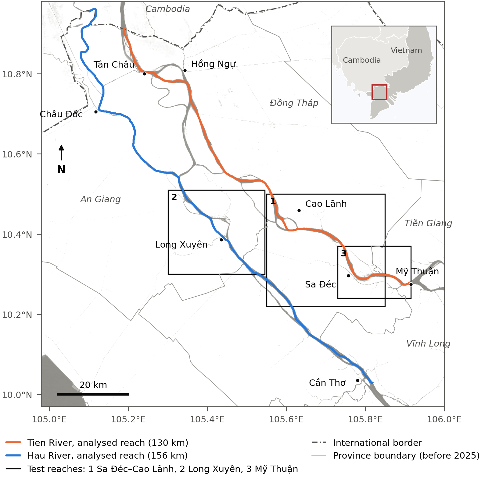
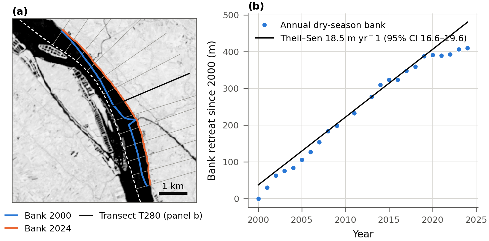
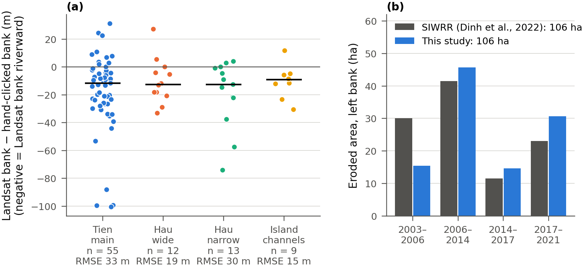
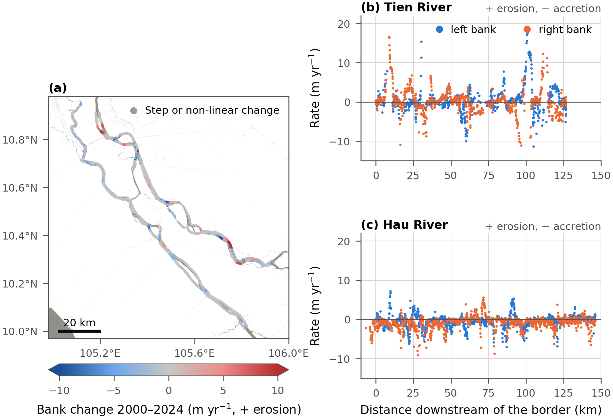
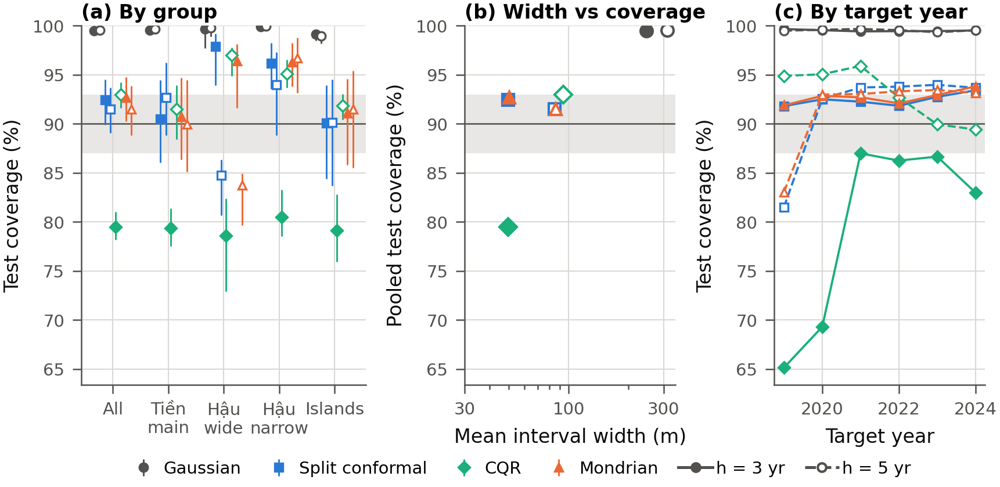
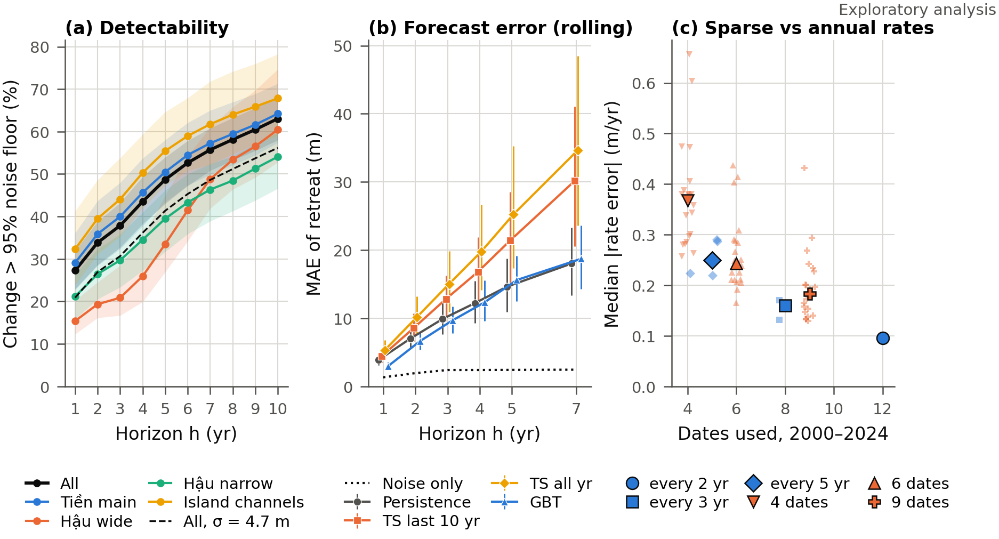
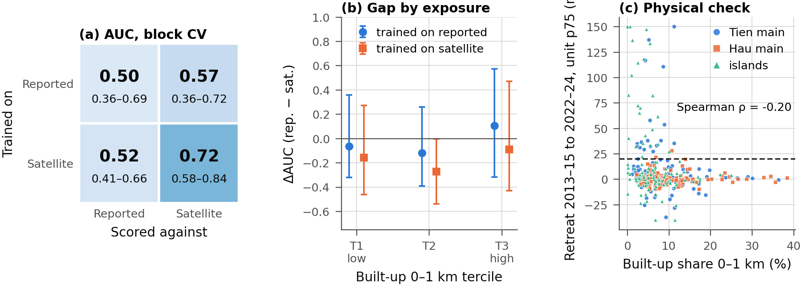
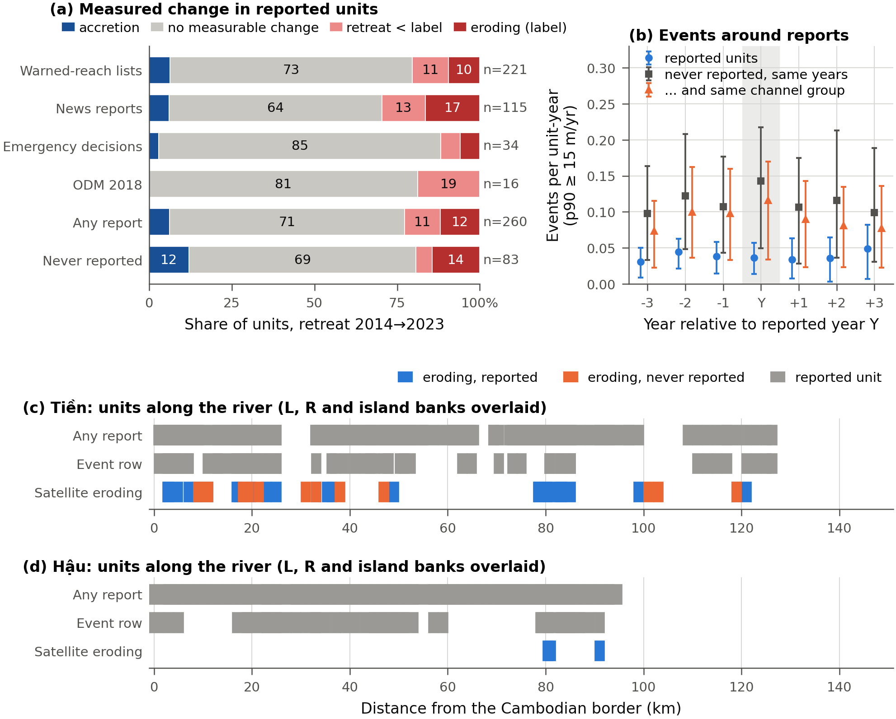
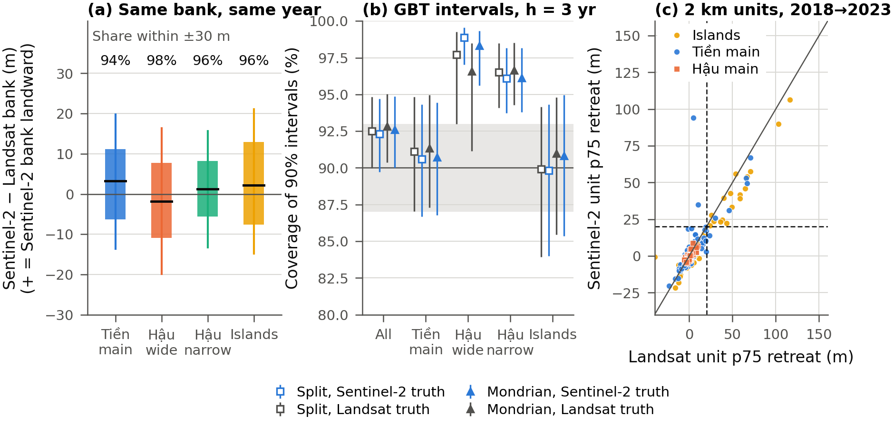
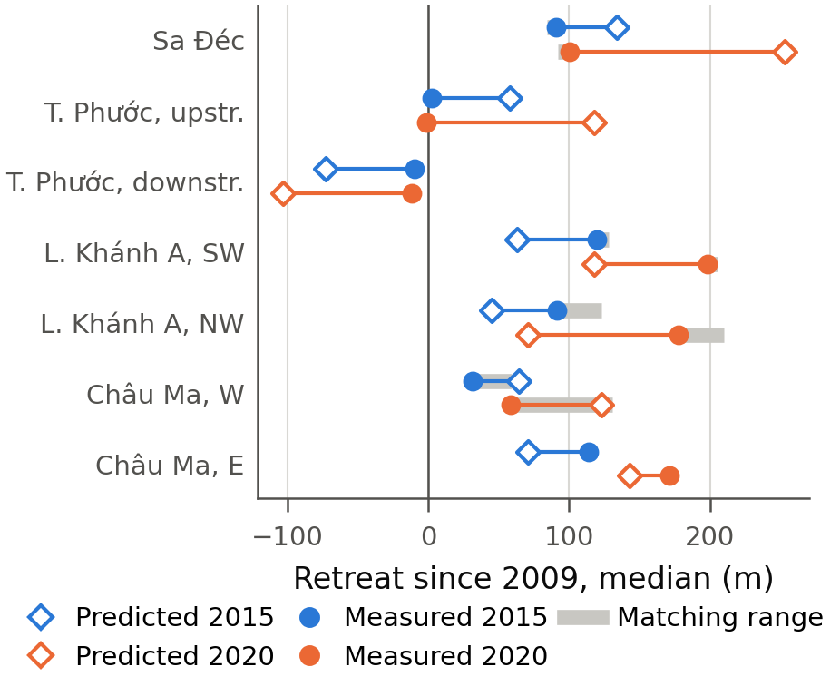

# Coverage-verified forecasts of riverbank retreat, Tien and Hau rivers (Vietnamese Mekong Delta)

Code, analysis protocol and results for the manuscript

> **Coverage-verified forecasts of riverbank retreat and the limits of public erosion reports as hazard labels: Tien
> and Hau rivers, Vietnamese Mekong Delta.** T. N. Le, M. H. Ho, V. N. Nguyen and T. B. Nguyen. In preparation for *Natural Hazards and
> Earth System Sciences*.

The repository measures annual dry-season riverbanks from Landsat (2000–2024) every 100 m along 273 km of the Tien and
Hau rivers and around all eleven river islands of 1–150 km². It then tests, under a protocol frozen before any forecast
was scored, whether learned models beat persistence (H1), whether conformal prediction intervals keep their nominal
coverage on held-out years (H2), and whether erosion-susceptibility scores depend on the label source, public reports or
satellite-measured retreat (H3).

**Interactive atlas:** <https://tronghia256-edgeai.github.io/mekong-bankline-forecast/atlas/> (annual banklines 2000–2024,
erosion labels, reported sites, unreported eroding reaches and a 2027 forecast band).

**Status:** analyses complete; manuscript under internal revision. The numbers below may change with the revision and
are not yet peer reviewed.

## Study area and workflow



*The Tien and Hau rivers from the Cambodian border to the My Thuan and Can Tho bridges. Boxes: reaches used for accuracy
checks (1 Sa Dec–Cao Lanh, 2 Long Xuyen, 3 My Thuan). Background: JRC Global Surface Water occurrence.*


*Workflow. Three lanes lead from the data (grey) through processing (blue) and products (purple) to the confirmatory
hypotheses H1–H3 (orange): annual banks to forecasts and intervals, banks to satellite labels, and public reports to
reported labels. Exploratory analyses and robustness checks (green) concern all results.*

## Main results

| | Result | Source |
|---|---|---|
| H1, point forecasts | Not supported. Gradient boosting and Gaussian processes did not beat persistence at 3 or 5 years (test MAE 9.9 vs 9.3 m at 3 years). | [results/p2/forecast.md](results/p2/forecast.md) |
| H2, 90 % intervals | Supported for pooled coverage. Split and Mondrian conformal intervals covered 92.4 % and 92.7 % at 3 years and 91.5 % at 5 years on the 2019–2024 test period. Coverage is marginal: 97 % at stable banks, 60 % at banks retreating faster than 10 m/yr; a post hoc Mondrian calibration by past retreat rate raised the latter to 86 %. | [results/p2/forecast.md](results/p2/forecast.md), [results/p4/posthoc.md](results/p4/posthoc.md) |
| H3, label source | Not supported as specified. The reported label marks 76 % of the 2 km bank units and is unrelated to measured retreat (Cohen's κ = −0.01). | [results/p2/h3.md](results/p2/h3.md) |
| Exploratory | 12 of 43 satellite-eroding units are absent from the public reports we retrieved; a blind check on high-resolution imagery confirmed land loss at 9 of 11 assessable cases. | [results/p2/explore_reporting.md](results/p2/explore_reporting.md), [results/p2/visual_check.md](results/p2/visual_check.md) |
| Robustness | H2 unchanged when retreat is re-measured with Sentinel-2. H3 unchanged when reports are displaced 2–4 km. A 2010 deterministic forecast for the same banks missed by 29–152 m. | [results/p3/](results/p3/) |

The exploratory analyses were planned after the confirmatory results and have no pass/fail rule. All plans were written
and committed before their runs: [docs/protocol.md](docs/protocol.md), [docs/exploratory_plan.md](docs/exploratory_plan.md),
[docs/p3_plan.md](docs/p3_plan.md) and [docs/p4_posthoc_plan.md](docs/p4_posthoc_plan.md).

## Figures

### Bank measurement and accuracy



*Method at Binh Hang Trung (Tien left bank). (a) Dry-season banks of 2000 and 2024 on the 2024 MNDWI composite with
transects; (b) bank retreat on one transect since 2000 with its Theil–Sen trend.*



*Accuracy. (a) Landsat bank minus hand-clicked bank on Esri World Imagery Wayback by channel type (negative: Landsat bank
riverward); bars: median. (b) Left-bank eroded area at Binh Hang Trung per period, this study and the survey of Dinh et al.
(2022).*

### Bank change, 2000–2024



*(a) Theil–Sen rate per bank point (positive: retreat); grey: step or non-linear series. (b, c) Rates along the Tien and
Hau by distance from the border.*

### Forecasts and intervals (H1, H2)



*Coverage of 90 % prediction intervals on the 2019–2024 test period, h = 3 years (filled markers, solid lines) and
h = 5 years (open markers, dashed lines), with the 90 ± 3 % band. (a) By method and channel type; (b) pooled coverage
against mean width; (c) by test target year. Bars: 95 % block-bootstrap intervals over 10 km blocks.*



*Exploratory analysis A. (a) Share of bank points whose change exceeds the 95 % noise floor, by horizon and channel type;
(b) rolling-origin test MAE by horizon; (c) rate error of thinned series against annual rates.*

### Label sources and public reports (H3)



*Label-source comparison at 2 km units. (a) AUC of the logistic model trained on each label source and scored against
both; (b) ΔAUC by built-up tercile; (c) satellite window retreat against built-up share 0–1 km (dashed: 20 m label
threshold).*



*Exploratory analysis B. (a) Measured change of reported units by source type and of unreported units; (b) measured
unit-year events around the reported year; (c, d) units along the Tien and Hau.*

### Robustness



*Robustness to sensor resolution. (a) Sentinel-2 minus Landsat bank position, 2018–2024, by channel type; (b) coverage of
the frozen intervals against Sentinel-2 and Landsat truth; (c) unit retreat 2018–2023, Sentinel-2 against Landsat.*



*Verification of a 2010 deterministic forecast (Nguyen et al., 2010, ISPRS Archives): predicted against measured median bank retreat
since 2009 at seven site sides, for 2015 and 2020.*

Supplementary figures: [satellite erosion labels](figures/fig05_sat_labels.png),
[covariates](figures/fig06_covariates.png), [placement sensitivity of the reports](figures/figS1_placement.png).

## Repository layout

| Path | Contents |
|---|---|
| [`src/`](src/) | Pipeline: Earth Engine exports, bank extraction, reach units, labels, covariates, forecasts and conformal intervals, label-source tests, exploratory and robustness analyses, figures, data release, atlas |
| [`docs/protocol.md`](docs/protocol.md) | Frozen analysis protocol (git tag `protocol-v1`) with every deviation, dated |
| [`docs/paper_notes.md`](docs/paper_notes.md) | Figure list and captions, key numbers with their source files, decisions, licences, limitations |
| [`docs/atlas/`](docs/atlas/) | Interactive web atlas (static HTML, Leaflet) with banklines, unit labels and a 2027 forecast band |
| [`results/`](results/) | Generated reports, one Markdown file per analysis (`p0` method checks, `p1` accuracy and labels, `p2` hypotheses and exploratory analyses, `p3` robustness) |
| [`figures/`](figures/) | Publication figures (300 dpi PNG and SVG) |
| [`paper/`](paper/) | Manuscript in Copernicus LaTeX (one file per section and table), verified bibliography, number checker |
| [`data/tiles.json`](data/tiles.json) | River centerlines, processing tiles and island definitions |
| [`data/hotspots/`](data/hotspots/) | Erosion inventory: candidate rows, review verdicts and the final `inventory.csv` |
| `data/raw/`, `data/processed/` | Earth Engine exports and intermediate tables (not in git; regenerated by the pipeline) |

## Reproducing the analysis

### Environment

Python 3.10 on Windows or Linux. A CPU is enough, because the raster compositing runs in Google Earth Engine.

```bash
pip install -r requirements.txt
gcloud auth application-default login     # Earth Engine credentials (application default credentials)
```

Set `PROJECT` in `src/gee_water.py` and `src/gee_s2.py` to your own Earth Engine Cloud project (noncommercial use is
free). Every later step runs locally.

### Pipeline

Run from the repository root. Each script writes its report to `results/` and documents its inputs and outputs in its
header.

| Step | Command | Output |
|---|---|---|
| 1. Tiles and islands | `python src/river_tiles.py` | `data/tiles.json` |
| 2. Landsat composites, per tile | `python src/gee_water.py <tile>` (each tile and island in `data/tiles.json`) | `data/raw/<tile>/mndwi_<year>.tif` |
| 3. Banks per tile | `python src/banklines.py <tile>` | `data/processed/<tile>/bank_positions.csv`, `trends.csv` |
| 4. Stitching | `python src/stitch.py tien`, `python src/stitch.py hau` | `data/processed/{tien,hau}/` |
| 5. Reach units and islands | `python src/reach_units.py`, then `python src/islands_merge.py` | `data/processed/units.csv`, `data/processed/islands/` |
| 6. Labels and covariates | `python src/sat_labels.py`, `python src/covariates.py`, `python src/inventory_final.py` | 2 km unit tables, `data/hotspots/inventory.csv` |
| 7. H1 and H2 | `python src/forecast.py` (about 35 min) | `results/p2/forecast.md`, figure 7 |
| 8. H3 | `python src/h3.py` | `results/p2/h3.md`, figure 8 |
| 9. Exploratory A, B | `python src/explore_horizon.py`, `python src/explore_reporting.py` | figures 9 and 10 |
| 10. Robustness | `python src/p3_sentinel2.py` (after `gee_s2.py` and `s2_banks.py`), `python src/p3_placement.py`, `python src/p3_isprs2010.py` | `results/p3/` |
| 11. Release and atlas | `python src/release.py`, `python src/forecast_2027.py`, `python src/atlas_build.py` | `release/`, `docs/atlas/` |
| 12. Figures | `python src/figures.py` | `figures/` |

The hand checks were done in small local web tools: accuracy clicks with `review_server.py`, the inventory review with
`inventory_server.py`, and the blind visual check with `visual_check.py`. Their answers are stored in the repository, so
the analyses rerun without them.

Before any hand-over of the manuscript, `python paper/check_numbers.py` checks the key numbers in the manuscript (`paper/`)
against the results files.

## Data

- **Imagery:** Landsat 5/7/8/9 Collection 2 Level 2 and Sentinel-2 surface reflectance, through Google Earth Engine.
- **Ancillary layers:** JRC Global Surface Water, GHSL built-up, WorldPop, VIIRS night lights, OpenStreetMap and Kontur
  Boundaries (pre-2025 communes).
- **Erosion inventory:** public provincial warned-reach lists, news reports, emergency decisions, the 2018 MARD erosion
  WebGIS (via Open Development Mekong) and Open Development Vietnam landslide points, 2015–2024. Every row within the
  study scope was checked against its source.
- **Data release:** annual bank positions and banklines, trends, unit labels and covariates, the reviewed inventory, the
  unreported eroding reaches and the accuracy clicks. They are archived on Zenodo, doi:[10.5281/zenodo.23665677](https://doi.org/10.5281/zenodo.23665677)
  (reserved; the link works once the record is published). `python src/release.py` builds the release locally; its documentation is
  [docs/release_README.md](docs/release_README.md).

Measured accuracy against hand-clicked banks on Esri World Imagery Wayback (RMSE): 33 m on the Tien main channel, 19 m on
the wide Hau, 30 m on the narrow Hau and 15 m on island channels. Repeatability is 3.1 m per composite. The full
validation is in [results/p0/](results/p0/) and [results/p1/](results/p1/).

## Licence

- **Code:** MIT ([LICENSE](LICENSE)).
- **Bank data:** derived bank positions, trends and unit labels are released under CC BY 4.0.
- **Inventory and commune data:** CC BY-SA 4.0 and ODbL (© OpenStreetMap contributors), because they include share-alike
  sources.
- **Imagery:** Esri imagery was used for visual checks only; none is redistributed.

## Citation

The manuscript is in preparation. Until it is published, please cite this repository and the tagged commit you used.

## Authors

Le Trong Nghia, Ho Minh Hieu and Nguyen Viet Nam (students), and Nguyen Thien Bao (advisor, corresponding author).
Institute of Intelligent and Interactive Technologies (3ITech), University of Economics Ho Chi Minh City (UEH), Vietnam.
